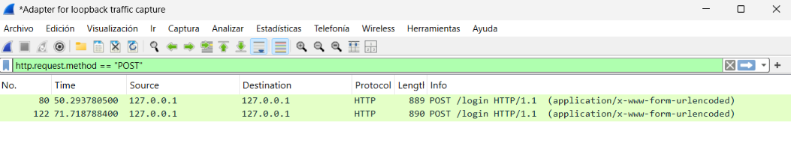
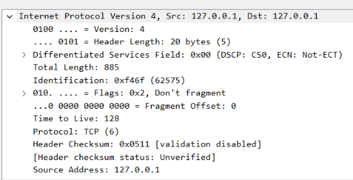
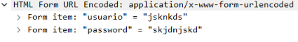
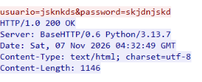
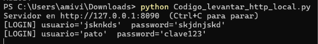

# Desafío 2: Captura de un login HTTP inseguro (Wireshark)

**Escenario:** capturar con Wireshark un inicio de sesión sobre HTTP (sin cifrar),
aislar el login con un filtro, identificar IP de origen y destino y encontrar las
credenciales que viajan por la red.

## Proceso
1. Levanté el servidor de prueba entregado por mis compañeros
   (`Codigo_levantar_http_local.py`, escucha en `127.0.0.1:8090`). Antes de
   ejecutarlo revisé el código: solo usa `http.server` y `urllib.parse`, escucha
   únicamente en loopback y no ejecuta comandos ni se conecta a internet.
2. **Detalle importante:** el servidor corre en `127.0.0.1` (loopback), así que
   capturar en la tarjeta de red activa (Wi-Fi/Ethernet), como dice el
   enunciado, no habría mostrado nada.
   **Solución:** iniciar la captura en la interfaz
   **Adapter for loopback traffic capture** (viene con Npcap).
3. Entré a `http://127.0.0.1:8090` desde el navegador e inicié sesión con datos
   inventados (`jsknkds` / `skjdnjskd`). Luego detuve la captura.
4. Apliqué el filtro `http.request.method == "POST"` y quedaron aislados los
   paquetes del login (80 y 122).

## Resultados

| Misión | Resultado |
|---|---|
| IP de origen | `127.0.0.1` (puerto de origen 62035, efímero) |
| IP de destino | `127.0.0.1` (puerto de destino 8090, el del servidor) |
| Filtro para aislar el login | `http.request.method == "POST"` |
| Tesoro (credenciales) | `usuario = jsknkds` / `password = skjdnjskd`, visibles en texto plano en *HTML Form URL Encoded* y en el Flujo TCP |

Como origen y destino son la misma IP (tráfico local), lo que distingue al
cliente del servidor son los puertos: 62035 → 8090.

## Evidencias
- Filtro aplicado: 
- Capa IP del paquete 80: 
- Credenciales en el formulario: 
- Flujo TCP: 
- Consola del servidor con el `[LOGIN]`: 

## Apoyo de IA
Usé Claude (Anthropic) con estas consultas:
- "¿Es seguro ejecutar este código que hicieron mis compañeros?" (revisión del script)
- "¿Dónde está Adapter for loopback traffic capture?"
- "¿Dónde está Internet Protocol para analizar el paquete POST? Explícame paso a paso, no sé usar Wireshark"

Me sirvió para entender la ruta de archivos, elegir la interfaz loopback y
ubicarme en la interfaz de Wireshark.

## Conclusión
HTTP envía los datos en texto plano: bastó capturar el tráfico y abrir un solo
paquete POST para leer usuario y contraseña, aunque el login fuera inventado e
incluso fallido. En una red compartida, cualquiera que pueda capturar tráfico
vería lo mismo. La solución es usar HTTPS (TLS), que cifra el contenido.
También aprendí que la interfaz de captura debe coincidir con el lugar por
donde pasa el tráfico (aquí, loopback), y a revisar el código de terceros
antes de ejecutarlo.
